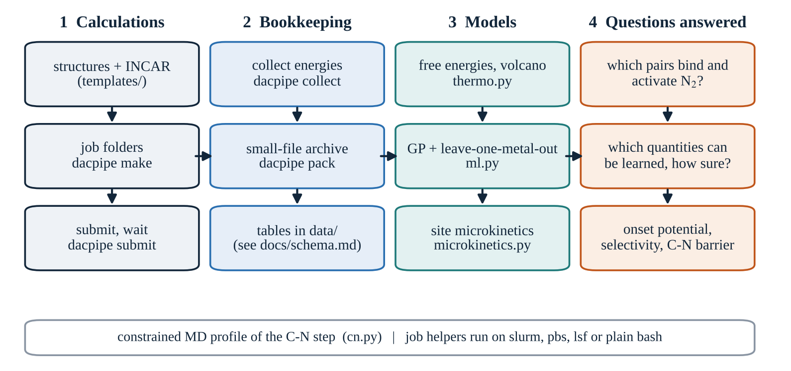
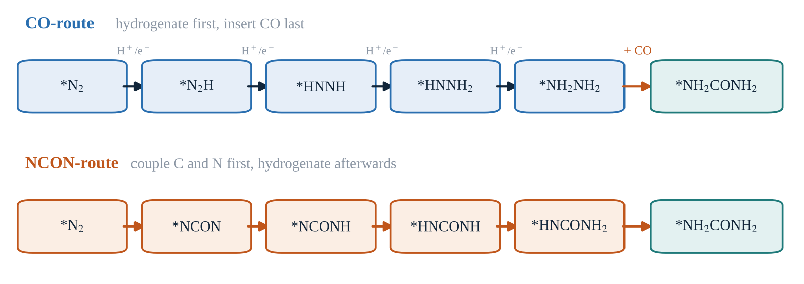
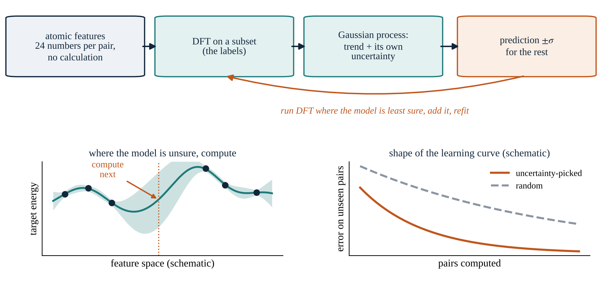
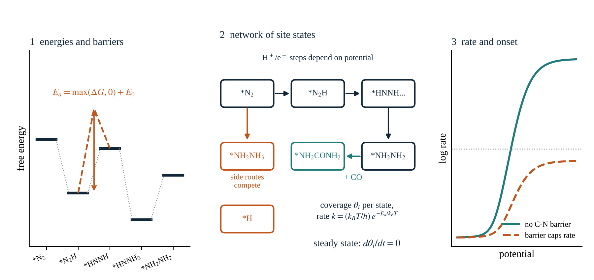
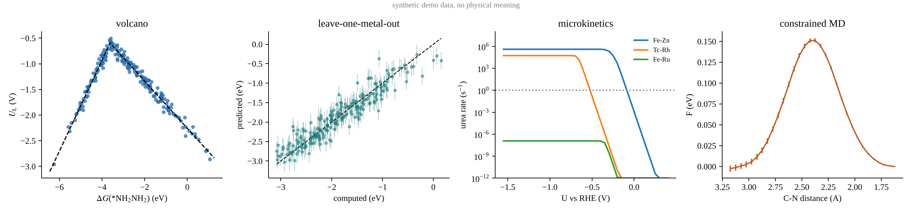

# dacpipe

Tools for screening dual-atom catalysts in a framework support, written around the electrochemical synthesis of
urea from N2 and CO. The repository holds the pipeline only, there is no data in it. You bring your own
calculations; the code handles the job folders, the free-energy bookkeeping, a physics-informed learning model,
a site-level microkinetic model and the analysis of constrained MD runs.



## What is in here

| module | what it does |
|---|---|
| `jobs.py`, `cli.py` | build one folder per calculation, submit (slurm, pbs, lsf or plain bash), collect energies, pack small files with a checksum |
| `features.py` | 24 atomic features for a metal pair, built from tabulated element properties |
| `thermo.py` | step free energies on the computational hydrogen electrode, limiting potential, volcano from the scaling of the two competing steps |
| `ml.py` | Gaussian process (ARD Matern plus a linear term), leave-one-metal-out validation, interval calibration, uncertainty-driven selection |
| `microkinetics.py` | 11-state mean-field network for one site, steady state in high precision, onset potential and Faradaic split |
| `cn.py` | free-energy profile along a distance coordinate from blue-moon MD output |
| `demo.py` | synthetic tables, only for tests and the walkthrough |

### Two routes to the same product



The CO-route hydrogenates N2 first and inserts CO at the end. The NCON-route couples C and N first. Both are
built from the same step-free-energy columns described in [docs/schema.md](docs/schema.md).

### Learning model

The learning model uses atomic features that follow the d-band picture (filling, position, coupling of the
d-states), a kernel with a linear part for trends along a series, and a screening rule that ranks pairs by the
probability of meeting the activity and stability limits. Validation removes every pair containing one metal at a
time, so the error you see is the error on a chemistry the model has not met.



### Kinetics

Each step gets a barrier `max(dG, 0) + E0`, where `E0` is an intrinsic barrier you set. The steady state of the
coverages gives the rate of urea, ammonia and hydrogen, and from those the onset potential and the selectivity.



## Install

```
python -m venv .venv
source .venv/bin/activate          # Windows: .venv\Scripts\activate
pip install -e ".[dev]"
python -m pytest -q
```

Python 3.10 or newer. A conda file is provided too (`conda env create -f environment.yml`).

## Try it without data

```
python examples/walkthrough.py
```

runs the volcano, the learning model, the kinetics and a constrained-MD profile on synthetic tables and writes
the figure below. The numbers are random draws and carry no chemistry.



## Running your own calculations

```
dacpipe init config.toml                     # edit scheduler, cores, modules, vasp_cmd, potcar_dir
dacpipe make tasks.csv --root jobs           # templates/ has an example task table
dacpipe submit jobs --dry-run                # check first, then run without --dry-run
dacpipe collect jobs calculations.csv        # energies, convergence flags, magnetization
dacpipe pack jobs results.tar.gz             # small files only, writes a .sha256 next to it
```

The pseudopotentials are licensed and never packed; `potcar_dir` must hold one folder per element with a `POTCAR`
inside. For a different DFT code change `vasp_cmd` and extend `read_outcar` in `jobs.py`, nothing else depends on
the code you run.

From there load your tables with pandas, give them the columns in [docs/schema.md](docs/schema.md), and call the
functions in `thermo`, `ml` and `microkinetics` as `examples/walkthrough.py` does.

## Notes

- The urea release step in the microkinetic model is a parameter (`REL_DEFAULT`), pass your own value.
- Constrained MD profiles from a fast drive are upper bounds on the barrier.
- `data/`, `jobs/`, `results/` and anything that looks like a potential or a wavefunction are ignored by git.

## Redrawing the graphics

`python docs/make_graphics.py` rebuilds the schematics in `docs/img/`.

## License

MIT, see `LICENSE`.
